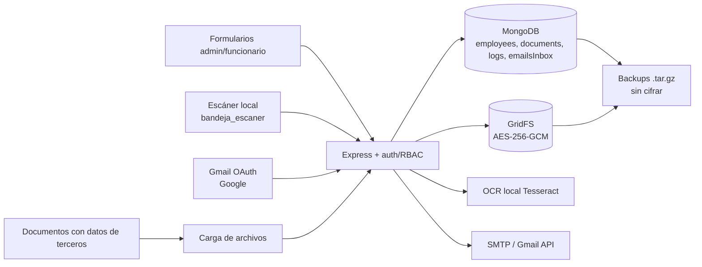

# Informe de auditoría de cumplimiento normativo

**Sistema:** Gestión Documental y Talento Humano — Alcaldía de Valledupar  
**Commit auditado:** `370cfaa` (`git rev-parse --short HEAD`)  
**Fecha del informe:** 23 de octubre de 2026  
**Naturaleza:** revisión técnica de cumplimiento; no es concepto jurídico. Requiere validación del área jurídica.

## 1. Resumen ejecutivo

- Se evaluaron 22 requisitos de las normas solicitadas: **0 cumple plenamente, 8 parciales, 10 no cumplen, 1 no verificable y 3 no aplican** al alcance actual.
- Los controles técnicos de base son razonables: AES-256-GCM para todos los documentos en GridFS, bcrypt, JWT en cookie httpOnly, RBAC, límites de tasa, CSRF, Helmet/CSP y bitácoras.
- La brecha más grave es el **borrado destructivo sin TRD, sin retención legal y sin doble control**: un administrador puede eliminar documentos y funcionarios completos de forma irreversible.
- La supresión de un funcionario **no es total**: quedan correos propios en `emailsInbox`, el campo `user` de `auditLogs`, y se inserta un nuevo log con la cédula del titular.
- No existe **política de tratamiento**, autorización firmada del titular, autorización separada para datos sensibles, TRD/CCD aprobada, contratos de encargados ni evidencia de RNBD.
- La retención es un **plazo global de 10 años** por `registeredAt`; no distingue series, no usa la TRD y no protege documentos con valor histórico o legal vigente.
- Los **refresh tokens de Gmail y los secretos TOTP están en claro** en MongoDB; los backups `.tar.gz` son locales y no están cifrados.
- El sistema no acredita **integridad documental**: no hay hash, versión, firma, sello de tiempo ni original inmutable; las descargas solo se registran en consola.
- El riesgo residual es **alto** para la entidad: pérdida de documentos, exposición de datos sensibles, sanciones de la SIC y falta de valor probatorio.

## 2. Alcance y metodología

- Revisión estática de código, HTML, scripts y documentación del repositorio en el commit `370cfaa`; no se ejecutó el sistema en producción.
- No se accedió a Railway, MongoDB, Google Workspace, backups, expedientes reales ni al panel de variables de producción.
- No se revisaron contratos, actas de comité, TRD, política de tratamiento, RNBD, registros de solicitudes ni expedientes físicos.
- Estados usados: **Cumple**, **Parcial**, **No cumple**, **No verificable** y **No aplica**. “No verificable” exige evidencia del operador; no equivale a incumplimiento probado.
- Se verificó la vigencia normativa al 23-oct-2026: el **Acuerdo AGN 001/2024** está vigente y el marco anterior fue derogado; la **Resolución MinTIC 02277/2025** actualiza el MSPI del Decreto 338/2022.
- No se encontró importación masiva desde Excel: los `.xlsx` se aceptan como archivos documentales, no como fuente estructurada de datos.
- El OCR es local (`documentAnalyzer.js:1-8`); no se encontraron APIs externas de IA ni envío de documentos a terceros por esa vía.
- Las capturas de configuración de Railway/MongoDB/Google no están disponibles; deben anexarse por el operador.

## 3. Inventario y mapa de datos

| Flujo | Datos personales | Almacenamiento | Destinatarios | Retención / observación |
| --- | --- | --- | --- | --- |
| Alta de funcionario | Cédula, nombre, correo, dependencia, cargo, hash de contraseña, consentimiento | Colección `employees` | Admin y titular | Hasta borrado; consentimiento v1 sin firma (`server.js:2324-2341`) |
| Carga, escáner y expediente | PDF/Office/imágenes, nombres de archivo, descripción, fechas, tipo/categoría; pueden incluir datos de ciudadanos o terceros | GridFS cifrado + `documents` | Admin; titular si es visible | 10 años global; sin TRD ni inventario de terceros (`server.js:1331-1348`) |
| Correo institucional y personal | Remitente, destinatario, asunto, snippet, adjuntos, tokens OAuth | `emailsInbox`, `config`, `employees` | Admin o titular de la bandeja; Google | Sin TTL; metadatos y tokens persisten (`server.js:4115-4135`) |
| Autenticación y seguridad | Correo, nombre, IP, intentos, acciones, cédula en detalles | `auditLogs`, `securityLogs`, `loginAttempts`, `errorLogs` | Admin | `errorLogs` 30 días; auditoría/seguridad sin plazo (`db.js:183-194`) |
| Escáner local | Documentos potencialmente sensibles | `bandeja_escaner/` sin cifrar | Usuario del equipo | Hasta registro o limpieza manual (`server.js:84-86`) |
| Backups | Toda la base, GridFS, tokens y metadatos | `backups/*.tar.gz` local | Operador | 10 copias; sin cifrado (`scripts/backup.js:112-128`) |
| Navegador | `th_user` (nombre, correo, rol) y consentimiento | `localStorage` | Titular | Hasta cierre/limpieza; banner de almacenamiento (`public/utils.js:121-180`) |

## 4. Matriz de cumplimiento

| # | Requisito | Norma | Evidencia verificada | Estado | Brecha |
| --- | --- | --- | --- | --- | --- |
| 1 | Finalidad, aviso y contacto | Ley 1581/2012 art. 9; Decreto 1377/2013 | `public/privacy.html:45-99` | Parcial | Sin política enlazada, dirección/teléfono, transferencias ni procedimiento de derechos |
| 2 | Autorización previa, expresa e informada | Ley 1581/2012 art. 9; Decreto 1377/2013 | `server.js:2301-2303`, `2335-2340`; `public/admin.html:962-969` | No cumple | Checkbox del admin; sin firma, alcance, versión del texto ni prueba del titular |
| 3 | Datos sensibles | Ley 1581/2012 arts. 5-7; Decreto 1377/2013 | `public/privacy.html:62-67`; `server.js:1105-1114` | No cumple | No hay autorización expresa separada; el cifrado no sustituye la autorización |
| 4 | Derechos del titular | Ley 1581/2012 arts. 14-16; Decreto 1377/2013 | `server.js:2166-2190`, `2465-2476`, `2379-2430` | Parcial | Solo corrige el nombre; sin revocatoria, oposición ni registro/plazos de solicitudes |
| 5 | Política de tratamiento | Ley 1581/2012 art. 13; Decreto 1377/2013 | No se encontró documento; `public/privacy.html:94` la menciona | No cumple | El aviso no equivale a política aprobada y disponible |
| 6 | Registro de actividades y RNBD | Ley 1581/2012 art. 25; Decreto 1377/2013 | `README.md:126-145` (acción pendiente) | No verificable | Sin evidencia de inscripción ni registro de actividades de tratamiento |
| 7 | Encargados y transferencias | Ley 1581/2012 arts. 18-19; Decreto 1377/2013 | `server.js:3845-3848`, `3870-3875`, `4268-4274`; `README.md:32`, `123` | No cumple | Google/Railway/Mongo/SMTP sin DPA ni aviso de transferencia internacional |
| 8 | Medidas de seguridad | Ley 1581/2012 art. 17; Decreto 338/2022 | `db.js:428-443`; `server.js:327`, `378-441`; `lib/crypto.js:23-49` | Parcial | 2FA opcional, cookie condicionada a `NODE_ENV`, secretos en claro y backups sin cifrar |
| 9 | Retención y minimización | Ley 1581/2012 arts. 4-8; Ley 594/2000 | `server.js:4620-4646`; `docs/legal/politica-retencion-actual.md:8-19` | No cumple | Plazo global de 10 años; no TRD; logs y correos sin plazo |
| 10 | Gestión documental, TRD y expediente | Ley 594/2000; Decreto 1080/2015; Acuerdo AGN 001/2024 | `server.js:1331-1348`; `db.js:13-30` | No cumple | Solo tipos/categorías; sin series, CCD, TRD, índice, folios ni transferencia |
| 11 | Eliminación documental | Ley 594/2000; Acuerdo AGN 001/2024 | `server.js:2662-2684`, `2379-2430` | No cumple | Borrado físico directo y masivo; sin acto, comité, muestras ni retención legal |
| 12 | Integridad y autenticidad del documento electrónico | Ley 527/1999 | `server.js:1331-1348`, `2615-2659` | No cumple | Sin hash, versión, firma, sello de tiempo ni original inmutable |
| 13 | Trazabilidad de solicitudes y plazos | Ley 1437/2011; Ley 1755/2015 | `server.js:2687-2813` | No aplica | No hay módulo PQRS; si se habilita, faltan plazos y notificaciones |
| 14 | Transparencia, datos abiertos y accesibilidad | Ley 1712/2014; Decreto 1081/2015 | `public/accesibilidad.html:46-63` | No aplica | No es portal de transparencia; validar sitio institucional y auditoría WCAG |
| 15 | Control de acceso y segregación | Ley 1581/2012 art. 17; Decreto 338/2022 | `server.js:987-1004`; `db.js:9`; `server.js:1835-1961` | Parcial | Un solo admin con todos los permisos; 2FA no obligatorio; sin doble control |
| 16 | Auditoría y bitácoras | Ley 1581/2012 art. 17; Decreto 338/2022 | `server.js:1059-1068`, `720-731`, `3011`; `db.js:183-194` | Parcial | Descargas solo en consola; logs mutables, sin cadena de integridad ni retención |
| 17 | Gestión de incidentes | Decreto 338/2022; Res. MinTIC 02277/2025 | `server.js:736-784`, `4360-4377` | Parcial | Alertas y `errorLogs`, pero sin plan, clasificación, preservación ni notificación |
| 18 | Backups y continuidad | Decreto 338/2022; Ley 527/1999 | `scripts/backup.js:106-128` | Parcial | `.tar.gz` local sin cifrar; sin RTO/RPO ni prueba de restauración obligatoria |
| 19 | Minimización en correo | Ley 1581/2012 art. 4; Decreto 1377/2013 | `server.js:4041`, `4115-4135`, `3894-3903` | No cumple | Sincroniza todo adjunto del buzón; metadatos sin TTL; alcance Gmail amplio |
| 20 | Habeas data financiero | Ley 1266/2008 | No se encontró tratamiento de crédito/financiero | No aplica | Revisar documentos cargados por terceros; el sistema no es una base financiera |
| 21 | Secretos y credenciales | Ley 1581/2012 art. 17; Decreto 338/2022 | `server.js:1877`, `3873`, `4270`; `stat -c '%a' .env` = `755` | Parcial | TOTP y refresh tokens en claro; `.env` legible por terceros |
| 22 | Documentación de cumplimiento | Ley 1581/2012; Decreto 338/2022 | `README.md:84-101`; `docs/legal/validacion-retencion-documental.md:6-19` | No cumple | Afirmaciones de supresión total no exactas y norma AGN desactualizada |

## 5. Hallazgos por severidad

| ID | Severidad | Hallazgo | Evidencia | Impacto | Acción sugerida |
| --- | --- | --- | --- | --- | --- |
| H1 | Crítica | El borrado de funcionario elimina todos sus documentos y no suprime todos sus datos | `server.js:2389-2428` | Pérdida irreversible; PII residual; contradicción con Ley 1581 | Bloquear borrado masivo; retención legal; corregir anonimización y borrar correos propios |
| H2 | Crítica | Borrado físico directo y autoaprobación de solicitudes | `server.js:2662-2684`, `2765-2808`; `db.js:9` | Eliminación sin debido proceso; posible destrucción de prueba | Doble control, comité de archivo, retención y acto motivado |
| H3 | Alta | Falta de política, autorización, DPA/transferencias y RNBD | `public/privacy.html:45-99`; `server.js:2301-2340`; `README.md:126-145` | No se acredita base lícita ni responsable/encargado | Aprobar documentos y registrar RNBD/RAT con jurídica |
| H4 | Alta | Secretos privilegiados en claro y backups sin cifrar | `server.js:1877`, `3873`, `4270`; `scripts/backup.js:112-114` | Toma de Gmail, bypass de 2FA y exposición masiva | Cifrar campos/KMS, restringir `.env`, cifrar backups |
| H5 | Alta | Retención global sin TRD ni bloqueo legal | `server.js:4620-4646`; `docs/legal/politica-retencion-actual.md:8-19` | Pérdida de valor histórico o conservación excesiva | TRD por serie, plazos diferenciados y legal hold |
| H6 | Alta | Documento electrónico sin prueba de integridad | `server.js:1331-1348`, `2615-2659` | Bajo valor probatorio y riesgo de alteración | Hash, versión, firma/sello de tiempo y original inmutable |
| H7 | Alta | Accesos y descargas no auditados en base de datos | `server.js:3011`, `1059-1068`; `db.js:183-194` | Falta de accountability y exfiltración no detectable | Registrar lectura/descarga, append-only y retención |
| H8 | Media | Gmail sobreexpuesto y metadatos sin plazo | `server.js:3845-3848`, `4041`, `4115-4135` | Sobrecolección de correos y datos sensibles | Filtrar etiquetas/remitentes, TTL y registro de consentimiento |
| H9 | Media | Bandeja del escáner sin cifrado en disco | `server.js:84-86`, `3667` | Exposición local de documentos sensibles | Cifrar temporal, purgar y restringir acceso al equipo |
| H10 | Media | Documentación de cumplimiento inexacta o desactualizada | `README.md:84-88`; `docs/legal/validacion-retencion-documental.md:6-19` | Falsa confianza y hallazgos en revisión externa | Corregir afirmaciones y citar Acuerdo AGN 001/2024 |

## 6. Plan de acción priorizado

| Prioridad | Acción | Responsable | Resultado esperado |
| --- | --- | --- | --- |
| P0 (0-30 días) | Suspender borrado físico directo y borrado de funcionario; implementar `legal hold` y doble control | Técnico + Jurídico | Evita destrucción de documentos y prueba |
| P0 | Corregir supresión: no borrar documentos con retención; borrar `emailsInbox` propios; anonimizar `auditLogs.user`; no registrar cédula | Técnico | Supresión coherente y verificable |
| P0 | Cifrar TOTP/refresh tokens, cifrar backups, restringir `.env`, fijar `NODE_ENV=production` y 2FA obligatorio para admin | Técnico | Reduce exposición de secretos y sesiones |
| P1 (30-90 días) | Aprobar política de tratamiento, aviso, autorizaciones (incl. sensibles) y procedimiento de derechos | Jurídico + Administrativo | Base documental de licitud y prueba |
| P1 | Aprobar TRD/CCD, retención por serie y procedimiento de eliminación con Comité de Archivo | Jurídico + Archivo | Cumplimiento Ley 594/2000 y Acuerdo 001/2024 |
| P1 | Formalizar DPA/transferencias con Google, Railway, MongoDB y SMTP; inscribir RNBD/RAT | Jurídico + Administrativo | Encargados y transferencias documentados |
| P1 | Plan de incidentes, continuidad y pruebas de restauración | Técnico + Administrativo | Respuesta y recuperación demostrables |
| P2 (90-180 días) | Hash, versionado, firma/sello de tiempo y original inmutable | Técnico | Valor probatorio y conservación |
| P2 | Auditoría de lectura/descarga y retención de logs | Técnico | Trazabilidad completa y minimización |
| P2 | Auditoría WCAG, esquema de publicación y capacitación | Administrativo + Técnico | Transparencia y accesibilidad verificables |

## 7. Anexos: evidencia documental faltante

- Política de tratamiento de datos personales aprobada y publicada, con versión y fecha.
- Aviso de privacidad completo: dirección física, teléfono, procedimiento de derechos y transferencias.
- Formato de autorización del titular y autorización expresa de datos sensibles, con prueba y alcance.
- Registro de actividades de tratamiento (RAT) y soporte de inscripción/actualización en RNBD.
- TRD, CCD, acta de aprobación del Comité de Archivo y procedimiento de eliminación documental.
- Contratos/DPA con Google, Railway, MongoDB y proveedor SMTP; evaluación de transferencia internacional.
- Plan de respuesta a incidentes, registro de incidentes y procedimiento de notificación a SIC/titulares.
- Plan de continuidad, RTO/RPO y evidencia de pruebas de restauración.
- Matriz de roles/permisos, actas de asignación y evidencia de doble control.
- Procedimiento y registro de derechos del titular (acceso, corrección, supresión y revocatoria).
- Inventario de activos, análisis de riesgos y adopción del MSPI (Decreto 338/2022; Res. 02277/2025).
- Política de retención de logs, correos y backups; informe de accesibilidad y plan de mejora.
- Capturas de configuración: `NODE_ENV`, variables de Railway, TLS, backups y permisos de `.env`.

## 8. Límites y validación

- Este informe es una revisión técnica; no constituye concepto jurídico ni certificación de cumplimiento.
- Los estados “No verificable” y “No aplica” deben confirmarse con el operador y el área jurídica.
- No se probaron controles en runtime, no se hizo pentest ni revisión de vulnerabilidades de infraestructura.
- No se verificó la correspondencia entre el commit auditado y el despliegue real; `docs/pendientes.md:23-28` advierte deriva y posible servicio caído.
- La normativa debe revalidarse antes de decisiones formales; el marco archivístico cambió con el Acuerdo AGN 001/2024.

## 9. Cierre

- El sistema tiene una base técnica defendible, pero no acredita cumplimiento integral.
- La prioridad inmediata es detener el borrado destructivo y corregir la supresión incompleta.
- En 30-90 días deben existir política, autorizaciones, TRD, DPA y plan de incidentes.
- En 90-180 días debe cerrarse la brecha de integridad documental y auditoría de accesos.
- Sin esas acciones, el riesgo de pérdida documental, exposición de datos y sanción es alto.
- Las afirmaciones de cumplimiento del README deben corregirse para no inducir a error.
- Toda decisión de retención o eliminación debe validarse con jurídica y con el Comité de Archivo.
- La evidencia de configuración de producción debe anexarse antes de una revisión externa.

## Anexo A. Fuentes principales verificadas

- `server.js` (rutas, autenticación, borrado, retención, Gmail, auditoría).
- `db.js` (colecciones, índices, GridFS, cifrado).
- `lib/crypto.js` (AES-256-GCM y `DOC_ENC_KEY`).
- `public/privacy.html`, `public/terms.html`, `public/accesibilidad.html`.
- `docs/legal/politica-retencion-actual.md`, `docs/legal/validacion-retencion-documental.md`.
- `scripts/backup.js`, `README.md`, `docs/pendientes.md`.
- `public/index.html`, `public/utils.js`, `public/admin.html`, `public/funcionario.html`.

## Anexo B. Evidencia de configuración verificada

| Control | Comando o fuente | Resultado |
| --- | --- | --- |
| Commit auditado | `git rev-parse --short HEAD` | `370cfaa` |
| `.env` ignorado | `git check-ignore -v .env` | `.gitignore:2:.env` |
| Permisos de `.env` | `stat -c '%a' .env` | `755` (lectura para terceros) |
| `NODE_ENV` en despliegue | `railway.json:1-13`; búsqueda en el repo | No definido en el repositorio; verificar panel de Railway |
| `DOC_ENC_KEY` | `lib/crypto.js:23-49`; `.env.example:71-78` | Obligatoria solo en producción; fail-fast |
| Cookie segura | `server.js:327` | Depende de `NODE_ENV === 'production'` |
